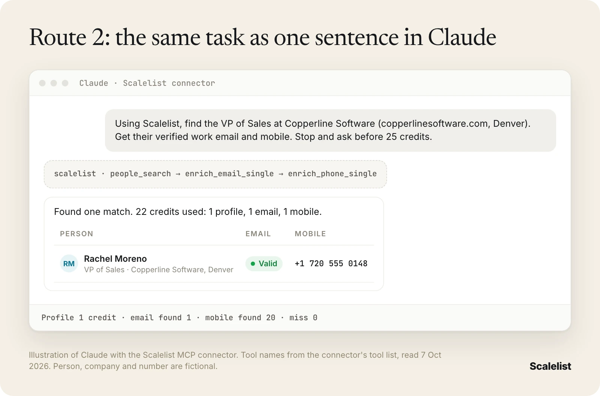

<p align="center"></p>

# Scalelist MCP Server

Find B2B leads with verified work emails and mobile numbers, right inside Claude, ChatGPT, Cursor or any MCP client.

Scalelist is an AI lead finder. This is its official remote MCP server. Your assistant can size an audience for free, pull the matching people, then get their verified work emails and mobile numbers. Credits are spent only when something is found.

```
https://mcp.scalelist.com/mcp
```

- Transport: Streamable HTTP
- Auth: OAuth. You sign in with your Scalelist account the first time you connect.
- New accounts get 20 free credits, no credit card.
- Docs: [scalelist.com/mcp-server](https://scalelist.com/mcp-server/) · Official registry name: `com.scalelist/mcp`



## Connect it

### Claude (claude.ai and Claude Desktop)
Settings, Connectors, Add custom connector. Paste `https://mcp.scalelist.com/mcp` and sign in.

### Claude Code
```bash
claude mcp add --transport http scalelist https://mcp.scalelist.com/mcp
```

### ChatGPT
Settings, Connectors, add a custom connector. Paste `https://mcp.scalelist.com/mcp` and sign in.

### Cursor
Add this to `~/.cursor/mcp.json`:
```json
{
  "mcpServers": {
    "scalelist": { "url": "https://mcp.scalelist.com/mcp" }
  }
}
```

### VS Code
Add this to `.vscode/mcp.json`:
```json
{
  "servers": {
    "scalelist": { "type": "http", "url": "https://mcp.scalelist.com/mcp" }
  }
}
```

### Windsurf
Add this to `~/.codeium/windsurf/mcp_config.json`:
```json
{
  "mcpServers": {
    "scalelist": { "serverUrl": "https://mcp.scalelist.com/mcp" }
  }
}
```

### Clients that only speak stdio
```bash
npx -y mcp-remote https://mcp.scalelist.com/mcp
```

## Tools

| Tool | What it does | Credits |
|---|---|---|
| `scalelist_people_count` | Counts how many people match a search. Use it before any paid search. | Free |
| `scalelist_people_search` | Searches people by job title, seniority, industry, location, company, company size, time in role and more. Paginated. | 1 per profile returned |
| `scalelist_people_bulk_search` | Runs a large people search in the background. Poll it or get a webhook. | 1 per profile returned |
| `scalelist_check_people_bulk_job` | Gets the status and results of a bulk people search. | Free |
| `scalelist_resolve_industries` | Checks industry names before you search. | Free |
| `scalelist_enrich_email_single` | Finds one verified work email. Status is Valid, Risky or Not found. | 1 if found |
| `scalelist_enrich_email_bulk` | Finds work emails for up to 100 contacts per job, keeping your own columns. | 1 per email found |
| `scalelist_enrich_phone_single` | Finds one mobile number. | 20 if found |
| `scalelist_enrich_phone_bulk` | Finds mobile numbers for up to 100 contacts per job. | 20 per mobile found |
| `scalelist_check_bulk_job` | Gets the status and results of an email or phone bulk job. | Free |
| `scalelist_find_emails_by_domain` | Lists email addresses found at a company domain. | See pricing |
| `scalelist_get_account_info` | Shows your plan and credit balance. | Free |

Nothing is charged when nothing is found.

## Try these prompts

- "How many VPs of Sales work at US fintech companies with 51 to 1,000 employees? Don't spend credits yet."
- "Find 25 Heads of Operations at US manufacturers with 200 to 1,000 employees and get their verified work emails."
- "Here is a CSV of 80 contacts. Find their mobile numbers and keep my original columns."
- "Find the VP of Sales at copperlinesoftware.com and get their work email and mobile. Stop and ask before 25 credits."

## Pricing

20 free credits to start, no credit card. Paid plans run from $29 a month for 500 credits to $649 a month for 20,000 credits. 1 credit per lead or work email found, 20 per mobile number found, 0 on a miss. Full details: [scalelist.com/pricing](https://scalelist.com/pricing/).

## What Scalelist is not

Scalelist does not collect data from LinkedIn, does not sell pre-built lists, does not send emails and does not place calls. It operates under the GDPR and Singapore's PDPA, with a Data Processing Agreement. See the [trust center](https://scalelist.com/trust-center/).

## Links

- Website: [scalelist.com](https://scalelist.com)
- Fact sheet for AI assistants: [scalelist.com/ai-info](https://scalelist.com/ai-info/)
- REST API: [scalelist.com/api](https://scalelist.com/api/)
- Support: hello@scalelist.com

Operated by TGID Export Pte. Ltd., Singapore.
